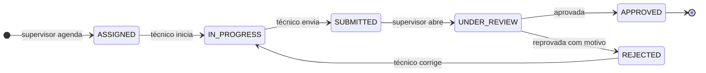

# FieldOps — Aplicativo Mobile

App de campo do FieldOps, para o técnico executar inspeções no ativo: receber a carteira do dia,
verificar o equipamento por QR Code, responder o checklist, registrar evidências fotográficas e não
conformidades, e enviar para revisão do supervisor.

Fala com a **mesma API** da interface administrativa ([`Project-FielOps/API`](https://github.com/Project-FielOps/API)), então tudo que o técnico faz aqui
aparece lá: as respostas entram na inspeção, as evidências ficam anexadas e as não conformidades
chegam para a revisão.

Stack: Expo SDK 57 (Expo Go), React Native 0.86, expo-router, TypeScript.

## O projeto FieldOps

Plataforma de **planejamento, execução e revisão de inspeções técnicas em campo**. Um supervisor
planeja a inspeção e monta o checklist na web; o técnico executa no celular, diante do ativo, com ou
sem sinal; o supervisor revisa, aprova ou reprova. Tudo fica auditado.

São três repositórios independentes:

| Repositório | O que é | Stack |
|---|---|---|
| [`API`](https://github.com/Project-FielOps/API) | Regras de negócio, autenticação, persistência e auditoria | Java 21 · Spring Boot 3.3 · PostgreSQL 16 |
| [`interface-administrativa`](https://github.com/Project-FielOps/interface-administrativa) | Web do supervisor: cadastros, modelos, planejamento e revisão | Angular 22 · Angular Material |
| [`aplicativo-mobile`](https://github.com/Project-FielOps/aplicativo-mobile) **← você está aqui** | App do técnico em campo | Expo SDK 57 · React Native |

### Arquitetura

```mermaid
graph LR
    subgraph campo["Em campo"]
        M["📱 aplicativo-mobile<br/>Expo Go"]
    end
    subgraph escritorio["No escritório"]
        W["🖥️ interface-administrativa<br/>Angular · :4200"]
    end
    subgraph servidor["Servidor"]
        A["⚙️ API<br/>Spring Boot · :8080"]
        D[("🗄️ PostgreSQL<br/>:5433")]
        F["📁 ./data/evidence<br/>fotos"]
    end

    M -->|"REST + JWT"| A
    W -->|"REST + JWT"| A
    A --> D
    A --> F
```



Não há comunicação direta entre o app e a web: **a API é o ponto de encontro**. O técnico responde o
checklist no celular e aquilo aparece na revisão do supervisor porque os dois falam com o mesmo
backend.

### Ciclo de vida de uma inspeção



| Etapa | Onde | Perfil |
|---|---|---|
| Cadastros, modelos de checklist, agendamento | Web | `ADMIN` · `SUPERVISOR` |
| Verificação do ativo, execução, evidências, não conformidades | Mobile | `TECHNICIAN` |
| Revisão, aprovação e reprovação | Web | `SUPERVISOR` |

### Subindo o ambiente completo

Na ordem — **banco → API → web / mobile**. Cada repositório detalha a sua parte no próprio README.

```bash
# 1. Banco (repositório API)
cd API && docker compose up -d

# 2. API — exige JDK 21; o Spring Boot 3.3.4 não roda bem em JDK mais novo
mvn -DskipTests package && java -jar target/fieldops-api-0.1.0.jar

# 3. Web
cd interface-administrativa && npm install && npm start

# 4. Mobile — celular na mesma Wi-Fi, aberto pelo Expo Go
cd aplicativo-mobile && npm install && npm start
```

| Porta | Serviço |
|---|---|
| `5433` | PostgreSQL (container) |
| `8080` | API · Swagger em `/swagger-ui.html` |
| `4200` | Interface administrativa |
| `8081` | Metro bundler (Expo) |

> No Windows, o firewall costuma bloquear entrada nas portas **8080** e **8081**. Se o celular não
> conectar no Expo Go, libere as duas para a rede privada.

### Credenciais de desenvolvimento

Criadas pelo seed da API (apenas no perfil `dev`, com o banco vazio):

| Perfil | E-mail | Senha | Usa |
|---|---|---|---|
| `ADMIN` | `admin@fieldops.local` | `Admin@12345` | Web |
| `SUPERVISOR` | `supervisor@fieldops.local` | `Supervisor@123` | Web |
| `TECHNICIAN` | `technician@fieldops.local` | `Technician@123` | **Mobile** |
| `CLIENT_VIEWER` | `viewer@fieldops.local` | `Viewer@12345` | Web |

### Identidade visual — FieldOps Precision System

Web e mobile compartilham o mesmo sistema de design, de estética *Ultra-Modern Minimalism*:
autoridade técnica, muito respiro e baixa carga cognitiva para quem opera em campo.

| Eixo | Regra |
|---|---|
| Tipografia | Plus Jakarta Sans nos títulos · Inter no corpo · JetBrains Mono em dado técnico |
| Cor de ação | `#2563EB` sólido; semânticas só em status, validação e alerta crítico |
| Formas | 16px em cards · 12px em botões e campos · 8px em badges |
| Elevação | Camadas tonais: fundo `#FAF8FF`, superfície `#FFFFFF` com contorno de 1px |
| Badges | *Soft fill*: 10% da cor no fundo, 100% no texto |
| Alvo de toque | Nunca abaixo de 44px — o app é usado em pé, com luva |

Os tokens vivem em `src/styles/_tokens.scss` (web) e `src/theme/` (mobile). Mudar a marca é mudar
esses dois arquivos.

---

## Pré-requisitos

- Node 20+
- App **Expo Go** no celular (Android ou iOS)
- Celular e computador **na mesma rede Wi-Fi**
- Backend ([`API`](https://github.com/Project-FielOps/API)) rodando e Postgres no ar

## Como rodar

```bash
npm install
npm start
```

Leia o QR Code com o Expo Go (Android) ou com a câmera (iOS).

### Como o app encontra a API

Não há IP no código. O app usa como host da API o **mesmo endereço pelo qual o celular alcançou o
Metro** (`Constants.expoConfig.hostUri`), assumindo a porta `8080`. Isso importa na prática: o IP da
máquina muda com a renovação de DHCP, e qualquer valor fixo quebraria na troca de rede.

Para apontar para outro ambiente, defina a URL completa:

```bash
EXPO_PUBLIC_API_URL=https://api.suaempresa.com/api/v1 npm start
```

> **Firewall:** o Windows costuma bloquear conexões de entrada nas portas 8080 (API) e 8081 (Metro).
> Se o celular não conectar, libere as duas para a rede privada.

## Credenciais de desenvolvimento

O app foi feito para o perfil **TECHNICIAN**. Com o seed do backend:

| Papel | E-mail | Senha |
|---|---|---|
| TECHNICIAN | `technician@fieldops.local` | `Technician@123` |

Administrador e supervisor também entram, mas as telas são desenhadas para a execução em campo — o
planejamento e a revisão ficam na interface administrativa.

## Telas

| Tela | O que faz | API |
|---|---|---|
| Login | Autenticação | `POST /auth/login`, `GET /auth/me` |
| Início | Progresso do dia, próxima inspeção, atalhos | `GET /inspections?technicianId=` |
| Inspeções | Lista com busca e filtros (Todas/Hoje/Em andamento) | `GET /inspections` |
| Detalhes | Ficha do ativo, instruções, portão de verificação | `GET /inspections/{id}`, `GET /equipment/{id}` |
| Scanner QR | Identifica o ativo e confirma que é o certo | `GET /equipment/by-qr/{qrCode}` |
| Checklist | Responde por seção, com o controle certo por tipo | `PUT /inspections/{id}/responses/{itemId}` |
| Câmera | Evidência fotográfica com coordenada | `POST /inspections/{id}/evidence` |
| Não conformidade | Registra desvio com severidade | `POST /inspections/{id}/non-conformities` |
| Resumo | Fechamento, pendências e envio | `POST /inspections/{id}/submit` |
| Histórico do ativo | Inspeções anteriores no mesmo equipamento | `GET /inspections?siteId=` |
| Sincronização | Estado da rede e fila de operações | — |
| Perfil | Sessão, ambiente e saída | `POST /auth/logout` |

## Offline primeiro

Inspeção acontece em subsolo, casa de máquinas e área rural. Assumir conectividade seria assumir
errado, então:

- **Toda escrita passa por uma fila** (`src/offline/queue.ts`), gravada em `AsyncStorage` e drenada
  na ordem de criação — a ordem importa, porque `submit` só pode chegar depois das respostas que o
  servidor valida.
- **Respostas são deduplicadas por item**: digitar não infla a fila, e o último valor é o que sobe.
- **Leitura tem cache** (`src/offline/cache.ts`): abrir um checklist sem sinal mostra o conteúdo
  guardado, em vez de uma tela de erro.
- **A fila drena sozinha** quando a rede volta (`NetInfo`), sem o técnico precisar lembrar.
- **Falha 4xx permanente sai da fila** (operação inválida — item já respondido, inspeção já enviada),
  senão ela entupiria para sempre. Falha de rede ou 5xx permanece e é tentada de novo.

## Sessão

O **refresh token** vai para o `SecureStore` (Keychain/Keystore): o aparelho é levado a campo e pode
ser perdido, então o segredo de longa duração fica sob proteção do sistema. O **access token** só
existe em memória, e o cliente HTTP o renova sozinho ao receber 401 — a renovação acontece dentro do
cliente, antes de qualquer tratamento de erro de tela, para o técnico não ser derrubado para o login
quando a sessão ainda podia ser salva.

## Verificação do ativo

O protótipo bloqueia o início da inspeção enquanto o técnico não confirma, no local, que está diante
do equipamento certo — é o que evita inspecionar o ativo vizinho e assinar por ele. O backend não
guarda esse estado (não existe endpoint), então ele vive no aparelho, por inspeção
(`src/inspection/verification.ts`).

## Identidade visual

Mesmo **FieldOps Precision System** da interface administrativa, portado para React Native em
`src/theme/`: Plus Jakarta Sans nos títulos, Inter no corpo, JetBrains Mono em dado técnico; card
16px / botão 12px / badge 8px; badges em *soft fill* (10% de fundo, 100% de texto); nenhum alvo de
toque abaixo de 44px, porque o app é operado com luva, em pé, às vezes sob chuva.

## Estrutura

```
app/                     rotas (expo-router)
  (tabs)/                Início, Inspeções, Sincronização, Perfil
  inspection/[id]/       detalhes, checklist, resumo, não conformidade, histórico
  scanner.tsx camera.tsx modais de câmera
src/
  api/                   cliente HTTP, endpoints e tipos espelhando os DTOs da API
  auth/                  sessão e restauração
  offline/               fila de escrita, cache de leitura, estado de rede
  inspection/            regras de resposta, item do checklist, verificação por QR
  components/            primitivas do design system
  theme/                 tokens e tipografia
```

## Limites conhecidos

- **Evidência por item**: a API só vincula evidência a uma resposta já persistida (`responseId`), que
  offline ainda não existe. A foto é enviada vinculada à inspeção, com o item identificado na
  descrição (`[item:<id>]`). Um `inspectionItemId` no endpoint de evidência resolveria isso melhor.
- **Histórico do ativo**: a API filtra inspeções por local, não por equipamento; buscamos o local e
  refinamos no cliente. Correto porque um equipamento pertence a um único local, mas um filtro
  `equipmentId` seria mais direto.
- **`rulesJson`**: a API carrega o campo, mas o construtor de modelos ainda não define um schema. O
  app lê `{min, max, unit}` de forma tolerante para mostrar a faixa-alvo; sem isso, o campo numérico
  funciona como número simples.
- **Notificações push** não fazem parte deste build.
- **Dados de demonstração**: o seed da API cria usuários, clientes, locais e equipamentos, mas
  **nenhuma inspeção**. Para percorrer o fluxo é preciso publicar um modelo de checklist e agendar
  uma inspeção para `technician@fieldops.local` — as duas coisas se fazem na interface
  administrativa. Sem isso o app abre corretamente, porém vazio.
